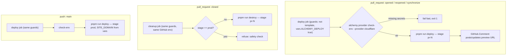
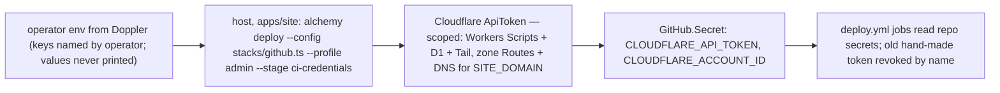

# SYS-900 alchemy CI and deploy shape - Plan

---

## Goal Capsule

- **Objective:** After this work, any repository created from this template that sets `vars.ALCHEMY_DEPLOY=true` gets, for each same-repo PR, an alchemy preview deploy whose URL is posted by the stack itself and whose stage is destroyed on close, and a push to `main` that deploys production in one job with no gate in front of it; the template repo itself ships that full shape dormant (its secret-touching jobs skip) with `check.yml` green; and the workspace resolves effect 4.1.0 with alchemy pinned to the reference consumer's post-bump tarball builds.
- **Means:** Replace the six-workflow CI/deploy tree with the alchemy CI guide's two-workflow shape (`check.yml`, `deploy.yml`), credentials as code via `stacks/github.ts` bootstrapped from the host, and the effect 4.0.7 → 4.1.0 / alchemy beta.80 → pkg.alchemy.run tarball bump (KTD2, KTD3, KTD7, KTD8).
- **Authority hierarchy:** SYS-900 ("Target for the starter", "Done when", "Does not count"), the owner's lane brief, and the conductor's post-review rulings override everything else in this repo. Repo law (CONSTITUTION.md, AGENTS.md) applies where they are silent; the two harness lines that described the old CI shape are updated in this PR with the owner's explicit authorization (KTD10).
- **Execution profile:** One lane, worktree `sys-900-alchemy-ci`, one PR to `main`, units U1–U5 in order. Commits use `git config user.name systemfsoftware-maker && git config user.email 248545757+systemfsoftware-maker@users.noreply.github.com` before the first commit — never the owner's identity. Roll-out to the other alchemy repos is out of scope (one PR per repo, later); frontend is where the deploy behaviors are first observed (KD5).
- **Stop conditions:** The SYS-900 "Done when" split (Definition of Done): the workflow-shape and dependency bullets are observed on this repo; the deploy-behavior bullets are observed on the first roll-out repo. "Does not count": keeping the gate, the mutation shards, or the secrets action under another name.
- **Worktree caveat:** This worktree was created with worktrunk hooks skipped, so `node_modules/`, `.cache/`, and the `post-start` hook outputs are absent; `.sfs-deps/` is present from a copy. U1's execution note covers what to run before installing.

---

## Product Contract

### Summary

Bring the starter kit to alchemy's own CI and deploy shape: one `check.yml` (bootstrap install + `turbo run format:check lint typecheck test --affected`), one `deploy.yml` (alchemy guide's `deploy` + `cleanup` jobs, dormant on the template behind a repository variable), credentials as code in `stacks/github.ts`, and the effect 4.1.0 / current-alchemy dependency bump. Delete the release gate, changesets, the standalone commitlint workflow, and both composite actions.

### Problem Frame

SYS-900 records why the starter is behind: prod deploys sit behind `release-gate.yml`, which re-runs all of CI plus Stryker mutation shards before `deploy · production` (.github/workflows/release-gate.yml:14-81); every CI step runs inside `nix develop` through a hand-written `dev-shell` action; Cloudflare credentials come from a hand-written `cloudflare-secrets` action; changesets and `pnpm-release-management` release machinery exist for an app that publishes nothing; commitlint is its own workflow; six workflows total 331 lines. Alchemy's own repo runs one `check.yml` and one `website.yml` that deploys `main` directly, and its CI guide specifies the two-job deploy shape with credentials as code. The owner asked for the starter to be state of the art, directly.

### Requirements

Workflow shape

- R1. `.github/workflows` holds exactly `check.yml` and `deploy.yml`, under 300 lines combined.
- R2. `check.yml` is one job: bootstrap install with cache, then `turbo run format:check lint typecheck test --affected` — the owner's single command, unchanged, with the root-only checks wired in as turbo dependencies of the matching tasks (KTD4).
- R3. Commitlint runs in the commit-msg hook (unchanged) plus one `check.yml` step that lints the PR range — the replacement for `commitlint.yml`'s backstop (KTD6).
- R4. `deploy.yml` has a `deploy` job that runs `alchemy provider check-env` first, computes stage `pr-<n>` on a pull request and `prod` on `main`, and runs the deploy with that stage.
- R5. `deploy.yml` has a `cleanup` job that runs destroy for `pr-<n>` when a pull request closes, with a safety refusal when the computed stage is `prod`.
- R6. A `GitHub.Comment` resource in the app stack posts the preview URL on each push to an eligible same-repo PR, updating in place.
- R7. `stacks/github.ts` mints a scoped Cloudflare API token, right-sized to what a D1 + Worker app with a custom domain needs, and writes `CLOUDFLARE_API_TOKEN` / `CLOUDFLARE_ACCOUNT_ID` into the repo as `GitHub.Secret` resources.
- R8. The bootstrap that deploys `stacks/github.ts` runs on the host, by the operator, outside every sandbox — never through `bin/cloud` — with a pinned stage and named, operator-supplied environment variables (KTD8).

Removals

- R9. `release-gate.yml`, `changeset-check.yml`, `release.yml`, `commitlint.yml`, `.github/actions/cloudflare-secrets/`, and `.github/actions/dev-shell/` are deleted.
- R10. The changesets surface an app doesn't need is removed after a grep shows nothing else uses it: `.changeset/`, `release.jsonc`, and the changeset entries in `gates.json`, `scripts/check-branch-rules.ts`, and `commitlint.config.ts`. The `pnpm-release-management` flake input stays — the grep shows it is load-bearing (KTD11).
- R11. Mutation testing is an on-demand package script (`apps/site` `mutation`: `stryker run`) and never gates a deploy or runs as a workflow; the orphaned shard planner `scripts/mutation-shards.ts` and its test are deleted with the gate.

Dependencies

- R12. `effect` and the workspace's existing `@effect/*` catalog packages move to 4.1.0 where a 4.x line exists (`@effect/opentelemetry`, `@effect/platform-node`, `@effect/platform-node-shared`, `@effect/sql-sqlite-do`); `@effect/tsgo` stays at its existing 0.63.0 pin (KTD3).
- R13. `alchemy` is pinned to the pkg.alchemy.run tarball builds the brief quotes, copying the exact quoted lines; the stack's needs add `@alchemy.run/cloudflare` and `@alchemy.run/github` (KTD2).
- R14. `pnpm why effect` shows 4.1.0.
- R15. No new tests and no new gates; existing typecheck, lint, and tests pass after the bump.

Safety and merge gating

- R16. No secret value is printed or committed. `deploy.yml`'s `deploy` and `cleanup` jobs carry `if: ${{ !github.event.repository.is_template && vars.ALCHEMY_DEPLOY == 'true' }}` — the template repo and any repo that has not opted in skip every secret-touching job; a fork or roll-out repo turns deploys on by setting the repository variable once. The Actions token reaches the stack under a CI-only environment name, never a blanket `GITHUB_TOKEN` passthrough.
- R17. The required status-check list shrinks to the new real context — `gates.json` and `scripts/check-branch-rules.ts` (with its test) name `check` only — and the lead applies the reduced ruleset to GitHub before this PR merges, so PRs cannot hang on contexts that no longer exist (KTD5).
- R18. `.github/workflows/deploy.yml` is repo-agnostic and copies verbatim into every alchemy app (the owner ordered this shape for all of them): it names no repository, domain, stage prefix, or app path specific to the starter. Its on-switch is the repository variable `vars.ALCHEMY_DEPLOY`, set in repo settings; everything repo-specific lives behind the root scripts `bootstrap`, `check-env`, `deploy`, `destroy`, in repository variables (`SITE_DOMAIN`), or in the alchemy stack (KTD12).

### Key Decisions

- KD1. Two-workflow CI/deploy shape; the release gate is removed, not relocated. Governs R1, R4, R9, R11. (session-settled: user-directed — chosen over keeping the gate or mutation shards in any form: SYS-900's Done-when names the two files and "Does not count" excludes the gate under another name.)
- KD2. Credentials as code via `stacks/github.ts`; the hand-written `cloudflare-secrets` action is deleted, not replaced. Governs R7, R8, R9. (session-settled: user-directed — chosen over the hand-written secrets action: SYS-900 lists the action under why-it's-behind.)
- KD3. effect 4.1.0 and the reference consumer's post-bump alchemy pins, copied verbatim from the brief. Governs R12, R13. (session-settled: user-directed — chosen over re-deriving versions or retyping tarball hashes: the brief says to copy the exact lines.)
- KD4. Mutation testing becomes an on-demand package script, not a scheduled or opt-in job. Governs R11. (session-settled: user-directed — chosen over the issue's "scheduled or opt-in job": the lane brief narrows it to a package script so `.github/workflows` holds only the two files.)
- KD5. The starter stays a credential-free template: the full deploy shape ships dormant behind `vars.ALCHEMY_DEPLOY`, and the deploy behaviors are proven on the first roll-out repo, not here. Governs R6, R16 and the Definition of Done split. (session-settled: user-directed — chosen over un-templating the repo: AGENTS.md:31 ("holds no credentials") stays, and every repo created from the template gets the working shape by setting one variable.)

### Key Flows

- F1. Preview lifecycle (on a repo with `vars.ALCHEMY_DEPLOY=true`; on the template the jobs skip)
  - **Trigger:** Same-repo pull request opened, reopened, or synchronized.
  - **Steps:** `deploy` job → `alchemy provider check-env --provider cloudflare` (same secret env as deploy, via `bin/cloud`) → `alchemy deploy --stage pr-<n>` → stack's `GitHub.Comment` posts/updates the preview URL.
  - **On close:** `cleanup` job → safety check (refuse `prod`) → `alchemy destroy --stage pr-<n>`.
  - **Covered by:** R4, R5, R6; AE1, AE2.
- F2. Production deploy (on a repo with `vars.ALCHEMY_DEPLOY=true`)
  - **Trigger:** Push to `main`.
  - **Steps:** `deploy` job with stage `prod`, `SITE_DOMAIN` from repo vars, no gating jobs.
  - **Covered by:** R4; AE3.
- F3. One-time credentials bootstrap (per roll-out repo; never on the template)
  - **Trigger:** Operator, once per roll-out repo, from the host — outside every sandbox (`bin/cloud` cannot run it: KTD8).
  - **Invocation:** from `apps/site`, with a pinned stage:
    `CLOUDFLARE_API_TOKEN=… CLOUDFLARE_ACCOUNT_ID=… GH_TOKEN=… pnpm exec alchemy deploy --config stacks/github.ts --profile admin --stage ci-credentials`
  - **Env:** `CLOUDFLARE_API_TOKEN` — an admin-scoped Cloudflare token (able to mint API tokens); `CLOUDFLARE_ACCOUNT_ID` — the target account; `GH_TOKEN` — a fine-grained PAT on that one repository with only Secrets write and a short expiry. Each is operator-supplied from Doppler, key named by the operator; values are never printed or committed.
  - **After:** confirm both repo secrets via `gh secret list` (names only), revoke the previous hand-made Cloudflare token in the dashboard (by name), and record the minted token's expiry and rerun cadence in the README CI-credentials section.
  - **Covered by:** R7, R8; AE5.

### Acceptance Examples

- AE1. On a repo with `vars.ALCHEMY_DEPLOY=true`, a same-repo PR is opened: `deploy.yml` runs the `deploy` job, stage `pr-<n>`; the PR shows a preview-URL comment authored by the `GitHub.Comment` resource; closing the PR runs `cleanup`, which destroys `pr-<n>` and never `prod`. On the template repo the same events skip both jobs. Covers R4, R5, R6, R16.
- AE2. The PR is synchronized: the comment updates in place (stable logical id) and the stage redeploys; the cleanup-on-close still fires exactly once. Covers R5, R6.
- AE3. On a repo with the variable set, a commit lands on `main`: the single `deploy` job deploys stage `prod` with no `ci`, `plan`, or `mutation` precondition. Covers R4.
- AE4. On the template repo, or any repo that has not set the variable: the secret-touching jobs skip with the guard visible in the run; no credential is read. Covers R16.
- AE5. On a roll-out repo the operator runs F3 once, from the host: two repo secrets are (re)written by the minted scoped token; the old hand-made token is revoked; no secret value appears in command output, logs, or the diff. Covers R7, R8, R16.
- AE6. A PR whose history includes a commit whose message violates the commitlint rules and that was made with `--no-verify` or outside the devShell: the `check.yml` commitlint step fails it, where the hook alone would have missed it. Covers R3.

### Scope Boundaries

- **In scope:** the starter repo's `.github/` tree, `stacks/github.ts`, the dependency bump, the removals in R9–R11, and the two authorized harness-line updates (STRATEGY.md's mutation boundary; AGENTS.md:34's job-shape line). Editing `.github/workflows` and deleting `.github/actions/` is explicitly authorized by the owner for this lane; every other harness file touched is named in this plan for the owner's gate (`gates.json`, `scripts/check-branch-rules.ts`, its test, `bin/cloud`, `turbo.json`, `commitlint.config.ts`, `dependabot.yml`, `README.md`, `STRATEGY.md`, `AGENTS.md` — the latter only for line 34; line 31 stays per KD5).
- **Non-goals:** keeping the gate, mutation shards, or secrets action under another name (SYS-900 "Does not count"); new tests; new gates; new CI jobs; changing the `.sfs-deps`/nix dependency-consumption model for `@systemfsoftware/*`; vendored subtrees under `repos/`; the roll-out PRs to the other alchemy repos (### Deferred to Follow-Up Work).
- **Deferred to Follow-Up Work:** roll-out of this shape to the other alchemy repos, one PR each, after the starter merges — frontend first, where F1/F2/F3 are observed. Each roll-out PR copies `.github/workflows/deploy.yml` verbatim from the starter, defines the root scripts `bootstrap`, `check-env`, `deploy`, `destroy` for its own app, and cites `git diff --no-index <starter>/.github/workflows/deploy.yml <repo>/.github/workflows/deploy.yml` with empty output; a drifted copy proves nothing for the starter.

---

## Planning Contract

### Key Technical Decisions

- KTD1. **The nix bootstrap stays, inlined — including the install step's full behavior.** Both new workflows run `cachix/install-nix-action@v31` + the AppArmor sysctl + `mkdir -p .cache` + `nix develop --command pnpm bootstrap` directly (inlining today's `dev-shell` action, which is deleted). `bootstrap` is what the action ran: sandboxed install, `pnpm rebuild --config.ignore-scripts=false`, and `pnpm run prepare` (the effect-tsgo patch) — a bare `pnpm install` would run unpatched tsgolint under `ignoreScripts: true`, silently weakening lint versus local. Forced in the first place: every `@systemfsoftware/*` dependency is a `file:.sfs-deps/*.tgz` catalog entry (pnpm-workspace.yaml:21 onward) and `.sfs-deps/` is materialized only by the devShell `shellHook` (flake.nix:59-62, 128-132) — a plain install has no tarballs to resolve. The deviation from the guide's plain `pnpm install` is the smallest one that installs correctly at all.
- KTD2. **Alchemy pins are the pkg.alchemy.run tarballs, unpatched.** npm `alchemy@2.0.0-beta.84` still imports `effect/Crypto`, removed in effect 4.1.0 — a runtime break, not a peer warning — so the tarball builds at upstream commit `68e87588fc…` are mandatory. Copy the brief's lines verbatim for `alchemy`, `@alchemy.run/cloudflare`, `@alchemy.run/github`. Requires `blockExoticSubdeps: false` (sibling packages ship as tarball URLs) and `minimumReleaseAgeExclude` entries for `alchemy` and `@alchemy.run/*` (mirroring the reference consumer's settings). No `patchedDependencies`: all four patches the reference consumer carries were read in full and are feature additions (ALCHEMY_PLAN_EXPORT, worker BundleTransfer/NativeExport, container-reconcile wait, git error typing), none effect-4.1 compat — if that exact bug appears during execution, port that hunk; otherwise ship unpatched. `@alchemy.run/cloudflare-runtime` is pinned (the reference consumer's exact line) only if the install closure demands it. The minted token's grants are right-sized, not the guide's full set: account-scoped Workers Scripts write, D1 write, Workers Tail read, plus zone-scoped Workers Routes write and DNS write for the `SITE_DOMAIN` zone; KV, R2, Queues, Pages, Account Settings and Secrets Store are dropped (KTD2/KTD8 own the flow; U4 owns the resource).
- KTD3. **Bump scope corrected by registry evidence.** `@effect/platform`, `@effect/workflow`, `@effect/ai`, `@effect/sql` have no 4.x line (npm dist-tags; that functionality moved into core `effect/http`, `effect/http-api`, `effect/workflow`) — the starter imports none of them (it already uses core v4-style `effect/http`, `effect/rpc`, `effect/Schema`). R12's set is exactly the four catalog packages with a 4.1.0. `@effect/tsgo` is already 0.63.0 — no change.
- KTD4. **Make the mandated command real and complete.** `format:check` is a root package.json script (`./bin/dprint check`), not a turbo task — and a plain `format:check` task definition would match no package and exit green doing nothing, so it registers as the root task `//#format:check` (the existing `//#typecheck:node` pattern) with repo-wide inputs. The owner's single command stays unchanged; the root-only checks ride along as turbo dependencies of the matching tasks: `typecheck` gains `//#typecheck:node`, `test` gains `//#test:scripts`, `lint` gains `//#lint:suppressions` and `//#format:check` as `dependsOn` entries (root tasks run once; turbo dedupes). `--affected` selects the root package only when a root-owned file changes, so an app-only PR would never reach the root tasks without that wiring, and a root-only PR would run no package task; `format:check` on `lint` covers the first, and a top-level `globalDependencies` list in `turbo.json` (the root-owned configs the package and root tasks consume: shared oxlint, stryker and tsconfig files, commitlint and lint-staged configs, `flake.nix`, `flake.lock`, `scripts/**`) covers the second by marking every package affected. Both gaps were reproduced with `turbo run ... --affected --dry=json` over an app-only commit and a root-scripts commit before the fix. `--affected` diffs against `main`, so `check.yml` checks out with `fetch-depth: 0` (a shallow checkout marks every package changed); that same history feeds the commitlint range. Accepted CI deltas, resolved with OQ1's ruling — dropped from CI, one line each: `journeys` (needs `bin/journeys` + the devShell's Playwright; stays local per START-5), `gate:dist` (the deploy build proves `apps/site`'s output), `check:sfs-sources` (the install itself fails loudly on any non-`file:` resolution), `test:sandbox` (nix-run sandbox proofs stay local), the branch-rules job (runs in U5's operator step instead).
- KTD5. **Required contexts shrink to `check` — in the file and on GitHub.** Today `gates.json:28-37` requires ten contexts including `journeys`, `rules`, `lint PR commits`, and the changeset check; `scripts/check-branch-rules.ts:4-15` hardcodes the same list and its test pins it. All three change together to `[check]`, and because `gates.json` is applied to GitHub by hand (README rulesets section), the lead PUTs this exact reduced ruleset to the live `main` ruleset before merging — an operator step owned by U5 and the Verification Contract; the in-PR file must match what the lead applies character for character. The context name is the job name: job `check` (`name: check`) in workflow `Check` (`.github/workflows/check.yml`) reports the status context `check`. Renaming either the job or the workflow changes the context and must change `gates.json`, `REQUIRED_CHECKS`, and its test together; this PR renames neither. The lead PUTs the ruleset requiring only that context once this PR's `check.yml` run is green.
- KTD6. **Commitlint: hook + CI step.** The hook (`.husky/commit-msg`) only fires inside the devShell (`core.hooksPath` set at flake.nix:128-130), so `--no-verify` and non-devShell commits escape it — exactly what `commitlint.yml:22` backstopped. `check.yml` gains one step running `pnpm exec commitlint --from <base.sha> --to <head.sha>` on pull_request events, skipping `dependabot[bot]` (preserving `commitlint.yml:12`).
- KTD7. **deploy.yml follows the guide's shape, mapped onto the starter's scripts, dormant on the template.** Triggers `push: main` + `pull_request` (opened/reopened/synchronize/closed); `permissions: { contents: read, pull-requests: write }`; `concurrency: deploy-${{ github.event.pull_request.number || github.ref }}`, cancel-in-progress false (a pull request keys by number on every action, because on a merged PR's `closed` event `github.ref` is the base branch, which would split cleanup from the preview deploy still running for the same stage); stage computed the guide's way but surfaced as `ALCHEMY_STAGE` because `pnpm run deploy` / `pnpm run destroy` (package.json:34-35) consume it and wrap everything in `bin/cloud` per AGENTS.md. Both jobs guard on `!github.event.repository.is_template && vars.ALCHEMY_DEPLOY == 'true'` — the variable is the opt-in, so a fork or roll-out repo enables itself by setting it once and no repo name is hard-coded. The cleanup job gets the same GitHub env as the deploy job (destroy deletes the stage's `GitHub.Comment`, so it needs GitHub too). The Actions token reaches alchemy under the CI-only name `ALCHEMY_GITHUB_TOKEN` — never a blanket `GITHUB_TOKEN` passthrough, which would carry a developer's ambient PAT into the sandbox. The guide's action pins are superseded by the repo's existing majors (`actions/checkout@v7`, `actions/cache@v6` as in ci.yml) for one pinning discipline. `isCloudStage` already accepts exactly `prod` and `pr-<n>` (apps/site/alchemy.run.ts:8), so no stage-handling changes; the stack name `Endgame` and the Cloudflare state backend are unchanged, so `prod` state carries over with no migration.
- KTD8. **Credentials as code lives at `apps/site/stacks/github.ts`, bootstrapped from the host.** Alchemy's project root here is `apps/site` (its `alchemy.run.ts`, its alchemy dependency), so the guide's `stacks/github.ts` sits under it and imports resolve through the app's dependencies. The one-time bootstrap (F3) runs on the host, by the operator, outside every sandbox — `bin/cloud` structurally cannot run it: the sandbox hands commands an empty `$HOME` (the `--profile admin` alchemy profile is unreadable), passes no `GH_TOKEN`, and allows no `api.github.com`; and `bin/cloud` is not "Doppler-backed" — it only passes through environment the caller already set. The invocation is pinned to stage `ci-credentials` so reruns update one stage instead of minting stray tokens, and names env vars only (`CLOUDFLARE_API_TOKEN`, `CLOUDFLARE_ACCOUNT_ID`, `GH_TOKEN`); sources are recorded as "operator supplies from Doppler, key named by the operator" and values are never printed. The app stack merges `GitHub.providers()` with `Cloudflare.providers()` so the `GitHub.Comment` resource resolves, and reads the Actions token from the CI-only `ALCHEMY_GITHUB_TOKEN` name. `bin/cloud`'s egress list gains `api.github.com` (reason in its header comment) so the CI-run comment and destroy can reach GitHub, alongside `--pass-env` for the CI-only token name, `PULL_REQUEST`, and `GITHUB_SHA`. (session-settled: user-directed — host-run bootstrap outside the sandbox, chosen over routing it through `bin/cloud`: the sandbox structurally cannot run it.)
- KTD9. **`@alchemy.run/frontend-frameworks` is dropped as unused** — ruled accepted by the conductor. Upstream did not fold it away; the drop stands on unused-dependency grounds: declared at `apps/site/package.json:14`, imported by no source file, the app's frontend runs on `@cloudflare/vite-plugin` + `@tanstack/react-start` (apps/site/vite-plugins.ts:10-13), and the npm beta.84 build is effect-4.0-only while keeping it would widen the tarball closure with `@alchemy.run/redis` and `@distilled.cloud/aws` for nothing.
- KTD10. **Mutation surface shrinks to the on-demand script; the two harness lines that described the old shape are updated in this PR.** `apps/site` keeps `"mutation": "stryker run"` (stryker.config.ts re-exports stryker.shared.ts, thresholds break 100). `release-gate.yml`'s plan/mutation jobs die with R9; `scripts/mutation-shards.ts` + `scripts/mutation-shards.test.ts` lose their only consumer and are deleted (their test was the `//#test:scripts` runner's, not a product test). With the owner's authorization for this PR: STRATEGY.md's "Mutation runs only on push to `main`" boundary becomes on-demand, and AGENTS.md:34's one-job-per-part / mutation-per-package line is rewritten for the two-workflow shape. AGENTS.md:31 ("holds no credentials") stays — KD5.
- KTD11. **`pnpm-release-management` stays.** The brief's removal was conditional on "a grep shows nothing else uses it"; the grep shows the opposite: it is the flake input providing `sandbox`, `mkPnpmConsumerStore`, and `sandbox-proofs` (flake.nix:12-29, 66, 79-89, 121), and every root script runs through `sandbox --` (package.json:25-48). Only the changesets/release half (R10) is removed. Conflict call-out on the brief's premise: it called this "wiring an app doesn't need" — the grep proves it is the local toolchain substrate.
- KTD12. **`deploy.yml` is the same file in every alchemy repo, so it carries no repo-specific string.** The starter is a GitHub template with no credentials, and its `deploy.yml` is the exact file frontend runs: frontend's preview comment, destroy-on-close, and main deploy are the proof of the starter's deploy shape only while the two files are byte-identical. The audit of the shipped file found one starter-specific string — `pnpm --filter @endgame/site` in the check-env step — now behind a root `check-env` script alongside `deploy` and `destroy`. The remaining literals are conventions, not starter facts: the `pr-<n>` / `prod` stage names are the alchemy guide's and are what `isCloudStage` accepts, `refs/heads/main` is the default branch, `SITE_DOMAIN` is read from a repository variable, and the stack name, app path, and package name live in `alchemy.run.ts` and the root scripts. The interface a repo must supply is therefore: root scripts `bootstrap`, `check-env`, `deploy`, `destroy`, the repository variable `ALCHEMY_DEPLOY` (and `SITE_DOMAIN` when serving a domain), and the two repository secrets from F3. (session-settled: user-approved — lead ruling relayed by the conductor, chosen over per-repo workflow edits: the proof only counts while the files are byte-identical.)

### High-Level Technical Design

Deploy lifecycle and stage decision (deploy.yml is the only writer of stages; stage strings are exactly the two `isCloudStage` accepts; both jobs are dormant unless the repo opts in via `vars.ALCHEMY_DEPLOY`):

One-time bootstrap (operator, host, per roll-out repo; never on the template, never through a sandbox):

### Assumptions

- The template repo holds no credentials and gains none (KD5); each roll-out repo runs F3 once before its first deploy. `SITE_DOMAIN` is a repository variable on repos that opt in.
- The `.sfs-deps`/flake consumption model for `@systemfsoftware/*` is unchanged by this plan; CI keeps materializing it through the flake shellHook.
- `ce-work` runs `pnpm bootstrap` inside the container before U1 (this hooks-skipped worktree has no `node_modules`) and commits with hooks once it exists — no `--no-verify` on code commits; lockfile-changing installs run on the host, never through the `sandbox` wrapper (it forces offline + frozen-lockfile against an old-store generation).
- Predicted effect 4.1.0 fallout in starter code is nil (the breaking list — `effect/Crypto`, persistence key layout, `KeyValueStore.make` `keys`, custom `FileSystem.glob`, `ChildProcess` shell syntax, `Toml.parse`, non-empty `sql.insert` rows, `AiError.HttpRequestDetails` — touches nothing the starter imports per the research dossiers); the typecheck in U1 is the proof, and the brief's "list what broke" is that typecheck's output. If a `@systemfsoftware/*` tarball breaks against 4.1.0, the fix path is bumping the `systemfsoftware` flake input (rebuilding `.sfs-deps`), not patching effect.
- The flake's pnpm-store builder (`mkPnpmConsumerStore` over `pnpm-lock.yaml`) has never seen URL-tarball resolutions; U1's first verification (`nix build .#pnpm-store`) proves it before anything else depends on the new lockfile.

---

## Implementation Units

### U1. Effect 4.1.0 + alchemy tarball pins + import migration

- **Goal:** The workspace resolves effect 4.1.0 and the current alchemy builds; the app's alchemy imports use the split packages.
- **Requirements:** R12, R13, R14, R15; KTD2, KTD3, KTD9.
- **Dependencies:** none.
- **Files:** `pnpm-workspace.yaml`, `pnpm-lock.yaml`, `apps/site/package.json`, `apps/site/alchemy.run.ts`, `apps/site/src/cloudflare-env.d.ts`.
- **Approach:**
  1. Catalog: `effect`, `@effect/opentelemetry`, `@effect/platform-node`, `@effect/platform-node-shared`, `@effect/sql-sqlite-do` → `4.1.0`; `@effect/tsgo` untouched; delete `@alchemy.run/frontend-frameworks` (KTD9); add `alchemy`, `@alchemy.run/cloudflare`, `@alchemy.run/github` tarball lines copied verbatim from the brief (KTD2).
  2. Workspace settings: `blockExoticSubdeps: false`; extend `minimumReleaseAgeExclude` with `alchemy` and `@alchemy.run/*`.
  3. `apps/site/package.json`: drop `@alchemy.run/frontend-frameworks`; point `alchemy` at `catalog:`; add `@alchemy.run/cloudflare` and `@alchemy.run/github` at `catalog:`.
  4. Migrate imports: `apps/site/alchemy.run.ts:2` and `apps/site/src/cloudflare-env.d.ts:1` from `alchemy/Cloudflare` to `@alchemy.run/cloudflare` (the bare `alchemy` import stays).
  5. Install on the host (never through `sandbox`), letting the lockfile re-resolve (the `@systemfsoftware/*` lock entries re-record their peers against 4.1.0).
- **Execution note:** Before any unit, `ce-work` runs `pnpm bootstrap` inside the container (no `node_modules` in this hooks-skipped worktree) and commits with hooks from then on — no `--no-verify` on code commits. Confirm `.sfs-deps/` is populated (90 tarballs per `.sfs-deps/index.json`); if missing or stale, run the skipped `install-deps` hook script from `repos/worktrunk-scripts/scripts/`. First verification of this unit: `nix build .#pnpm-store` succeeds on the new lockfile (the flake store has never seen URL-tarball resolutions). If typecheck surfaces breakage inside `@systemfsoftware/*` tarballs, bump the `systemfsoftware` flake input and rebuild `.sfs-deps` (Assumptions). This is mostly packaging/config: the proof is the install + typecheck + existing suites, not new coverage.
- **Patterns to follow:** the reference consumer's `pnpm-workspace.yaml` catalog and settings, as quoted in the brief, for the settings shape.
- **Test expectation:** none — no new tests allowed (R15); the existing `turbo` typecheck/lint/test suites are the proof, per Verification Contract.
- **Verification:** `nix build .#pnpm-store` green; `pnpm why effect` shows 4.1.0; `pnpm exec pnpm why @alchemy.run/cloudflare` resolves to the tarball; `pnpm typecheck && pnpm lint && pnpm test` green on the host.

### U2. check.yml cutover

- **Goal:** One `check.yml` job runs the mandated command with the root checks riding along; the workflows it replaces are gone.
- **Requirements:** R1, R2, R3, R9 (partial), R16; KTD1, KTD4, KTD6.
- **Dependencies:** U1 (the command's tasks must pass on the new pins).
- **Files:** `.github/workflows/check.yml` (new), `turbo.json`, delete `.github/workflows/ci.yml`, `.github/workflows/commitlint.yml`.
- **Approach:**
  1. `turbo.json`: declare `//#format:check` (root script `format:check` supplies the command; cache on; repo-wide inputs so app-only diffs still select it when the root is affected); add the three `dependsOn` wirings — `typecheck` → `//#typecheck:node`, `test` → `//#test:scripts`, `lint` → `//#lint:suppressions` (KTD4).
  2. `check.yml`: triggers `pull_request` (opened/synchronize/reopened), `push: main`, `workflow_dispatch`; `permissions: contents: read`; `concurrency: check-${{ github.ref }}` with cancel-in-progress on PRs; one job: `actions/checkout@v7` with `persist-credentials: false` and `fetch-depth: 0`, the inlined KTD1 bootstrap (`install-nix-action@v31`, sysctl, `mkdir -p .cache`, `nix develop --command pnpm bootstrap`), `actions/cache@v6` on `.turbo/cache`, then `nix develop --command pnpm exec turbo run format:check lint typecheck test --affected`, then the commitlint step (pull_request only, skipping `dependabot[bot]`): `nix develop --command sandbox -- pnpm exec commitlint --from <base.sha> --to <head.sha> --verbose` (KTD6).
  3. Delete `ci.yml` and `commitlint.yml` in the same unit so no commit references a deleted workflow.
- **Test expectation:** none — workflow/config only; `actionlint` plus a triggered run are the proof.
- **Verification:** `actionlint` clean; the triggered check run goes green on the PR — including a PR that touches only `apps/site`, proving the `//#format:check` wiring selects the root leg when expected; `wc -l` on track for R1.

### U3. deploy.yml cutover

- **Goal:** The guide's two jobs deploy previews and prod and destroy on close — dormant on the template, opt-in per repo — with no gate.
- **Requirements:** R1, R4, R5, R6, R9 (partial), R16; KTD1, KTD7, KTD8.
- **Dependencies:** U1 (new alchemy pins), U2 (workflow-count budget, no functional coupling).
- **Files:** `.github/workflows/deploy.yml` (new), delete `.github/workflows/previews.yml`, `.github/workflows/release-gate.yml`; `bin/cloud`; `apps/site/alchemy.run.ts`.
- **Approach:**
  1. `deploy.yml` per KTD7: `permissions: { contents: read, pull-requests: write }`; `ALCHEMY_STAGE` computed as the guide's ternary (`pr-<n>` on PR, `prod` on `refs/heads/main`); `deploy` job `if: github.event.action != 'closed' && !github.event.repository.is_template && vars.ALCHEMY_DEPLOY == 'true'`; steps: checkout (shallow is fine here), the KTD1 bootstrap, `nix develop --command pnpm run check-env` (root script wrapping `./bin/cloud pnpm --filter @endgame/site exec alchemy provider check-env --provider cloudflare`, so the workflow names no app; KTD12) carrying the same secret env block as the deploy step, then `nix develop --command pnpm run deploy` with env `CLOUDFLARE_API_TOKEN`, `CLOUDFLARE_ACCOUNT_ID`, `SITE_DOMAIN` (main only), `ALCHEMY_GITHUB_TOKEN: ${{ github.token }}`, `PULL_REQUEST`, `GITHUB_SHA`.
  2. `cleanup` job on `pull_request closed` with the same guards and the same env (destroy deletes the stage's comment resource, so it needs GitHub too): prod safety check first, then `nix develop --command pnpm run destroy`.
  3. `bin/cloud`: add `--allow-host api.github.com` (reason in the header comment) and `--pass-env` for `ALCHEMY_GITHUB_TOKEN`, `PULL_REQUEST`, `GITHUB_SHA` — never a blanket `GITHUB_TOKEN` passthrough.
  4. `apps/site/alchemy.run.ts`: merge `GitHub.providers()` with `Cloudflare.providers()` in the `Endgame` stack so the comment resource resolves; add the guide's `GitHub.GitHubEnv` + `GitHub.Comment` block — inside `if (github?.pr)`, a `GitHub.Comment` with a stable logical id whose body interpolates the site URL, reading the token from the CI-only `ALCHEMY_GITHUB_TOKEN` name.
- **Execution note:** Deploy smoke runs in CI on a roll-out repo (the PR's own preview) — the template repo's runs show the skip, which is its own acceptance (AE4). Do not deploy prod from the lane.
- **Test expectation:** none — workflow/infra only; F1/F2 are verified by the operator checks on the first roll-out repo.
- **Verification:** on a roll-out repo, the PR running this shape shows its own preview comment and a green deploy; on merge, `cleanup` destroys `pr-<n>`; on the template, both jobs show as skipped with the guard visible.

### U4. Credentials-as-code stack + operator docs

- **Goal:** `stacks/github.ts` mints a right-sized scoped token into repo secrets; the host-run bootstrap is documented exactly.
- **Requirements:** R7, R8, R16; KD2, KD5, KTD2, KTD8.
- **Dependencies:** U1 (package pins it imports).
- **Files:** `apps/site/stacks/github.ts` (new), `README.md`, delete `.github/actions/cloudflare-secrets/`, `.github/actions/dev-shell/` (now unreferenced by any workflow).
- **Approach:**
  1. `stacks/github.ts` per the guide, with KTD2's right-sized grants: `Alchemy.Stack("github", …)` merging `Cloudflare.providers()` + `GitHub.providers()`, `Cloudflare.state()`; `Cloudflare.ApiToken.AccountApiToken` with account-scoped Workers Scripts write, D1 write, Workers Tail read, plus zone-scoped Workers Routes write and DNS write for the `SITE_DOMAIN` zone; two `GitHub.Secret` resources writing `CLOUDFLARE_API_TOKEN` (token value) and `CLOUDFLARE_ACCOUNT_ID`.
  2. README gains a "CI credentials" section carrying F3 verbatim: the host-run invocation with `--stage ci-credentials`; the three env names and their shapes (admin-scoped Cloudflare token; account id; fine-grained PAT on that one repo, Secrets write only, short expiry); "operator supplies from Doppler, key named by the operator"; the post-bootstrap steps — confirm via `gh secret list` (names only), revoke the old hand-made Cloudflare token by name in the dashboard, record the minted token's expiry and rerun cadence. One line notes any new resource type needs its grant added there. Values are never printed.
- **Test expectation:** none — resource config + docs; the bootstrap is operator-verified on a roll-out repo (AE5).
- **Verification:** the lead/operator runs F3 once on the first roll-out repo; `gh secret list` afterwards shows both secrets (names only); the old token is revoked.

### U5. Gate truth + release/changeset/mutation surface removal + harness-line updates

- **Goal:** Required contexts match reality on disk and on GitHub; every dead release/changeset/mutation-planner artifact is gone trace-free; the two harness lines describing the old shape are corrected.
- **Requirements:** R9, R10, R11, R17; KTD5, KTD10, KTD11.
- **Dependencies:** U2 (the `check` context exists to be required), U3 (release-gate gone).
- **Files:** `.github/rulesets/gates.json`, `scripts/check-branch-rules.ts`, `scripts/check-branch-rules.test.ts`, `commitlint.config.ts`, `dependabot.yml`, `README.md`, `STRATEGY.md`, `AGENTS.md`; delete `.github/workflows/changeset-check.yml`, `.github/workflows/release.yml`, `.changeset/`, `release.jsonc`, `scripts/mutation-shards.ts`, `scripts/mutation-shards.test.ts` (six paths).
- **Approach:**
  1. `gates.json` required contexts → `["check"]`; `REQUIRED_CHECKS` in `scripts/check-branch-rules.ts` → same; its test's pinned list → same. The in-PR `gates.json` is exactly what the lead applies (KTD5).
  2. Operator step (Verification Contract): before merge, once this PR's `check.yml` run is green, the lead (admin) PUTs this reduced ruleset to the live `main` ruleset — it requires only the context `check` (job `check` in workflow `Check`, `.github/workflows/check.yml`) — runs `pnpm check:branch-rules`, and only then merges. Without it the PR hangs on the ten dead contexts.
  3. Delete the six dead paths listed above (the `.changeset/` ledger is the literal `{}`; `release.jsonc` is read only by the deleted reusable workflows; `pnpm-release-management` the flake input stays per KTD11).
  4. `commitlint.config.ts`: update the stale changesets comments — lines 7-8 and the line-62 mention — to state releases are plain `main` deploys.
  5. `README.md`: update the mutation FAQ and the release-gate/template-never-deploys text to the new shape (keeps the R10 trace grep at zero).
  6. `STRATEGY.md`: the mutation boundary becomes "on demand". `AGENTS.md`: line 34's one-job-per-part / mutation-per-package rule is rewritten for the two-workflow shape; line 31 stays untouched (owner-authorized edits, KTD10).
  7. `dependabot.yml`: prune any group/exclusion entries that reference the deleted paths; the `@commitlint/*` group stays (commitlint stays).
- **Test expectation:** none — config/gate-bookkeeping; `check-branch-rules`' own updated test still runs locally under `//#test:scripts` via the U2 wiring.
- **Verification:** the R10 grep (Verification Contract) returns nothing; `pnpm check:branch-rules` reports the ruleset and script in agreement after the lead's PUT.

---

## Verification Contract

| Check            | Command                                                                                                                                                                                                                                                  | Proves                                                      |
| ---------------- | -------------------------------------------------------------------------------------------------------------------------------------------------------------------------------------------------------------------------------------------------------- | ----------------------------------------------------------- |
| Nix store        | `nix build .#pnpm-store`                                                                                                                                                                                                                                 | KTD2/U1 — the flake store resolves the URL-tarball lockfile |
| Deps             | `pnpm why effect`                                                                                                                                                                                                                                        | R14 — effect 4.1.0 everywhere                               |
| Types            | `pnpm typecheck`                                                                                                                                                                                                                                         | R15, U1 fallout list                                        |
| Lint             | `pnpm lint`                                                                                                                                                                                                                                              | R15                                                         |
| Tests            | `pnpm test`                                                                                                                                                                                                                                              | R15                                                         |
| Format           | `pnpm format:check`                                                                                                                                                                                                                                      | R2's format leg                                             |
| Mandated command | `pnpm exec turbo run format:check lint typecheck test --affected`                                                                                                                                                                                        | R2 runs as written, root checks riding along                |
| Workflow lint    | `nix develop --command actionlint .github/workflows/*.yml`                                                                                                                                                                                               | R1, R4, R5 syntax                                           |
| Line budget      | `wc -l .github/workflows/*.yml`                                                                                                                                                                                                                          | R1 — total under 300                                        |
| Removal trace    | `git grep -nI -e changeset -e 'release.jsonc' -e mutation-shards -- . ':(exclude)docs/plans' ':(exclude)docs/brainstorms' ':(exclude).changeset'` (after U5: expect no matches, exit 1 — README and `commitlint.config.ts` are updated in the same unit) | R10, R11                                                    |
| Ruleset          | lead PUTs the reduced `gates.json` to the live `main` ruleset, then `pnpm check:branch-rules`                                                                                                                                                            | R17                                                         |
| Verbatim deploy  | `git diff --no-index <starter>/.github/workflows/deploy.yml <frontend>/.github/workflows/deploy.yml`                                                                                                                                                     | R18 — empty output on the roll-out PR                       |

Operator checks — on this repo (template): `.github/workflows` holds `check.yml` and `deploy.yml` only, under 300 lines; a PR shows `check.yml` green; `deploy.yml`'s jobs skip with the guard visible in the run; `pnpm why effect` shows 4.1.0. Operator checks — on the first roll-out repo (frontend, which takes this exact shape): F3 bootstrap once (host, `--stage ci-credentials`; the three env values operator-supplied from Doppler, keys named by the operator, never printed); a PR shows the preview-URL comment and its stage is destroyed on close; a main push deploys in one job.

---

## Definition of Done

Observed on this repo (the template):

- `.github/workflows` holds `check.yml` and `deploy.yml` only, under 300 lines together (R1).
- `check.yml` is green on a PR, running the owner's single command with the root checks riding along (R2).
- `deploy.yml`'s `deploy` and `cleanup` jobs skip with the `!is_template && vars.ALCHEMY_DEPLOY == 'true'` guard visible in the run (R16; AE4).
- `pnpm why effect` shows 4.1.0 (R14).
- `release-gate.yml`, `changeset-check.yml`, `release.yml`, `commitlint.yml`, and both composite actions no longer exist; the changesets surface is gone; mutation runs only as `apps/site`'s `mutation` script (R9–R11) — none of them survives under another name.
- STRATEGY.md's mutation line and AGENTS.md:34 describe the new shape; AGENTS.md:31 is unchanged (KTD10; KD5).
- The lead has applied the reduced ruleset requiring only the context `check` (job `check` in workflow `Check`; R17) once this PR's `check.yml` run is green — without it the PR cannot merge.
- No new tests, no new gates; `pnpm typecheck`, `pnpm lint`, `pnpm test` pass (R15).
- No secret value appears in any diff, log, or command output (R16).
- `deploy.yml` names no repository, domain, stage prefix, or app path specific to the starter (R18; KTD12): the audit finds none, and `git grep -nIE '@endgame|apps/site|starter' -- .github/workflows/deploy.yml` exits 1.

Observed on the first roll-out repo (frontend, which takes this exact shape):

- A PR shows a preview-URL comment (posted by `GitHub.Comment`) and its stage is destroyed on close (R4–R6; AE1/AE2).
- A main push deploys production in one job (R4; AE3).
- F3 ran once from the host; the old hand-made token is revoked (R8; AE5).
- frontend's `.github/workflows/deploy.yml` is byte-identical to the starter's. The roll-out PR cites `git diff --no-index <starter>/.github/workflows/deploy.yml <frontend>/.github/workflows/deploy.yml` with empty output. If they drift, the frontend deploy proof doesn't count for the starter.

Abandoned-attempt code from the bump or cutover is removed, not commented out.

---

## Sources

- SYS-900 (Linear; "Target for the starter" / "Done when" / "Does not count") — the contract.
- Conductor plan-gate rulings on review `934a16bc` (2026-10-30) — KD5, KTD7/KTD8 annotations, KTD4's coverage wiring, U5's operator steps.
- Alchemy CI guide: https://alchemy.run/environments/ci (canonical for https://alchemy.run/guides/ci/) — deploy.yml shape, check-env semantics, `stacks/github.ts`, `GitHub.Secret`, `GitHub.Comment`, bootstrap profile.
- alchemy-run/alchemy on main: `.github/workflows/check.yml`, `.github/workflows/website.yml`, `packages/alchemy/src/Cli/commands/provider.ts:19-48`, `packages/alchemy/src/Alchemist/Provider.ts:30-95`, `packages/github/src/index.ts`, package tree at commit `68e87588fc…` (frontend-frameworks still present).
- effect releases: `effect@4.1.0` (2026-10-29) release notes — breaking list; npm dist-tags for `@effect/platform` (0.97.2, no 4.x), `@effect/workflow`, `@effect/ai`, `@effect/sql`.
- The reference consumer's merged alchemy and effect bump, as quoted in the lane brief: its catalog and settings, and the four feature patches read in full.
- Local: `.github/workflows/*.yml` (six files, 331 lines), `.github/actions/*/action.yml`, `.github/rulesets/gates.json:28-37`, `scripts/check-branch-rules.ts:4-15`, `scripts/mutation-shards.ts`, `package.json:22-48`, `turbo.json:16-172`, `pnpm-workspace.yaml:8-138`, `flake.nix:59-135`, `apps/site/alchemy.run.ts`, `apps/site/package.json:14,31`, `apps/site/src/cloudflare-env.d.ts:1`, `bin/cloud:7-17`, `.husky/commit-msg:3`, `.changeset/ledger.yaml:1`, `release.jsonc`.
- STRATEGY.md — "Boundaries" (mutation line updated in this PR per KTD10) and "Cloudflare is the one deploy target".
