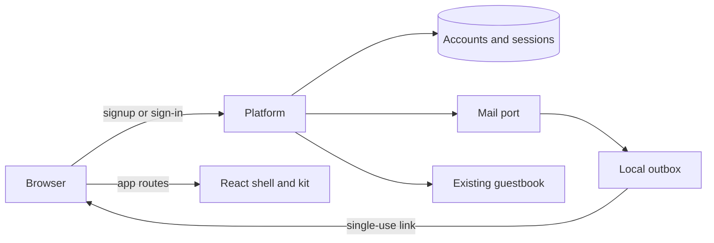

# Linework platform foundation - Plan

## Goal Capsule

- **Objective:** A person can run Linework locally without external accounts and sign in using an email link from a local outbox.
- **Means:** One local platform entry, an `/app/` React shell, account and mail boundaries, and a shared kit with Storybook (KTD1–KTD4).
- **Authority:** SYS-1037 R2, R8, R9, R11 and the seed/outbox portion of R13, as scoped by SYS-1038; the later conductor rulings in this plan; repository constitution and operating rules.
- **Execution:** One independent slice; retain the guestbook until its later removal. This document is a plan, not implementation authority.
- **Stops:** Do not edit a judgment surface. Escalate changes requiring owner decisions about identity, credentials or spending, and any conflict with the constitution. Do not treat a green CI badge as proof without the named artifacts.

---

## Product Contract

### Summary

Add the platform and shell that later Linework slices can extend, with working local account confirmation and sign-in. Add the shared component package and move the version bump into this slice.

### Problem Frame

The existing application exposes a guestbook rather than an account-bearing product. Its existing Worker and guestbook must continue to work while the foundation is added (`apps/site/alchemy.run.ts:17-30`; `apps/site/src/features/guestbook/guestbook-store.ts:44-74`).

### Requirements

**Accounts and outbox**

- R2. Sign-up sends a confirmation link; opening it creates a confirmed account and signs in. Reuse and expiry produce distinct plain messages. Sign-in sends a single-use link only to an existing account; an unknown account sees the same check-email screen without a link. Sign-out revokes the session and browser Back must not expose workspace data. States and refusals are tagged variants. The working link lifetime is 15 minutes pending owner confirmation (SYS-1037 R2).
- R13. The local outbox captures every email implemented by this slice at `/dev/outbox`; a person and a journey can read a working link there. `pnpm seed` recreates the demo data that exists at this slice, not future workspace and issue records (SYS-1037 R13.2–3; SYS-1038 scope).

**Interface and kit**

- R8. The screens in this slice work at 390, 768 and 1440 pixels, with keyboard access, understandable refusals and token-based light/dark themes. Lists in this slice have empty, loading and error/retry states; the 5,000-issue requirement belongs to the later issue slice (SYS-1037 R8).
- R9. `packages/kit` owns shared tokens and components. `pnpm storybook` lists every kit component in empty, loading, error and long-text states. The sign-in flow is a `@systemfsoftware/storybook-gherkin` feature running under `pnpm test` (SYS-1037 R9).

**Runtime and versions**

- R11. On PR opening day, use npm latest for Effect and its scoped packages, Alchemy and its Cloudflare provider, `@effect/tsgo`, Astro and Storybook. Use each `@systemfsoftware/*` package's flake-input `main` version. `pnpm run check:sfs-sources` must exit 0. The PR body records each old version, new version, lookup command and breaking change fixed. `@effect/tsgo` follows its own version, not the Effect version (SYS-1038 conductor ruling; `pnpm-workspace.yaml:17-21`).
- R13. After `pnpm bootstrap`, `pnpm dev` serves platform and React SPA under `/app/` at `http://localhost:1337`, with no Cloudflare account, API key, model key or outside network. `pnpm check:ci` and `pnpm journeys` must exit 0 in an environment allowed to run them (SYS-1038 Done).

### Scope Boundaries

- Keep the guestbook, its observable operations and journeys until slice 12. Its code and migrations may move without losing data or behavior.
- No workspaces, issues, agents, orchestrator, public marketing site, OAuth/MCP implementation, deploy, new CI gate or unrelated cleanup in this slice. Preserve a route for those later capabilities without implementing them.
- No new user-facing copy beyond sign-in and shell; obtain product copy through the design-round copy process rather than inventing it.
- The lint evaluator is updated separately by its owner, and this slice doesn't change it.
- Deployed sign-in needs a paid Cloudflare Email plan for arbitrary recipients; the owner owns that future deployment decision. There is no spend or dependency on it in this local slice ([Cloudflare Email Service](https://developers.cloudflare.com/email-service/)).

### Open Questions

- Email-link lifetime, default 15 minutes, owner to confirm.
- Blocking implementation prerequisite: validate that the selected auth library distinguishes expired from consumed links without inventing a duplicate authentication authority; the documented generic invalid-token response does not establish that distinction ([magic-link documentation](https://better-auth.com/docs/plugins/magic-link)).
- Blocking integration prerequisite: determine how the local Worker serves the SPA and later Astro output without breaking existing guestbook routing; the exact custom-entry and asset behavior at the final selected package versions remains unverified.

---

## Planning Contract

### Research First: Q2–Q6

1. **Q2, flake inputs.** Enumerate every catalog and override entry, including transitive `@systemfsoftware/*`, against the three sources in `flake.nix:18-35,59-64`. Read each source's `main` package metadata and the tarball index produced by the matching flake revision; record revision, package, old/new version and command. The checked-in catalog is not evidence of current `main` (`pnpm-workspace.yaml:23-59`). Do not use npm as the authority for these packages. The independent evaluator owner owns its own changes.
2. **Q3, breaking changes.** Compare the actual baseline and selected versions' exports, peer dependencies and release notes. SYS-900 already imports `@alchemy.run/cloudflare` (`apps/site/alchemy.run.ts:1`), so do not repeat the obsolete `alchemy/Cloudflare` migration claim. Inventory gherkin, schema-law, vitest and mutation-runner changes and every affected consumer. Record unresolved compatibility rather than changing an evaluator.
3. **Q4, composition.** Compare an Astro custom Worker entry with the existing Worker-first routing and SPA build. A reference application builds its Astro output separately and its platform routes SPA documents and static files separately; that is evidence for separating build outputs, not a reason to copy its implementation. Choose one public Worker entry and one stack, consistent with `STRATEGY.md:20-22`; prove deep links, assets, API routes and guestbook before committing to the packaging. The source-level capability of the selected `Website.Astro` version and local no-network startup are unverified until inspected.
4. **Q5, mail.** Use an Effect mail port and a local outbox implementation for this slice. Keep the outbox inaccessible in deployed stages. Deployed Cloudflare Email is deferred as stated in Scope Boundaries.
5. **Q6, authentication.** Compare owner packages' published interfaces with Better Auth and `@alchemy.run/better-auth`; do not hand-roll a library capability. Better Auth documents magic links and an OAuth provider with PKCE and a device grant, but its generic invalid-token behavior does not prove R2's distinct refusals ([magic links](https://better-auth.com/docs/plugins/magic-link), [OAuth provider](https://better-auth.com/docs/plugins/oauth-provider), [device authorization](https://better-auth.com/docs/plugins/device-authorization)). Read the selected versions' actual source and determine a compliant single authority before implementation. MCP's future HTTP authorization requires protected-resource metadata and authorization-server discovery ([MCP authorization](https://modelcontextprotocol.io/specification/2025-11-25/basic/authorization)); do not implement that future protocol in this slice.

### Key Technical Decisions

- KTD1. **One Worker-facing origin.** Route `/app/` and its client-side deep links to the SPA, API and local outbox to the platform, and preserve the guestbook. Keep Astro composition compatible with a later public-site slice rather than shipping its pages now. Asset precedence and the build handoff must be established by Q4.
- KTD2. **One auth authority with typed boundaries.** Resolve signup versus existing-account sign-in before requesting a link, preserve atomic single use, store only protected token material, and map expiry and reuse to distinct tagged refusals without a second independent verifier. Choose the library after Q6's source comparison; the provider integration, not a bespoke OAuth server, owns its supported protocol.
- KTD3. **Local-only outbox.** Persist readable development messages in local state and expose them only on the development route. The same mail port can receive a deployed adapter in a later slice. (session-settled: user-directed — chosen over making paid mail a prerequisite here: the present acceptance is local.)
- KTD4. **Shared kit and behavior stories.** The shell imports kit tokens and components; story states describe actual public states rather than fabricated independent components. The installed package describes Gherkin features as Storybook play functions (`.sfs-deps/storybook-gherkin-5.0.0.tgz`, package README; [public README](https://github.com/systemfsoftware/systemfsoftware/tree/main/packages/gherkin/storybook-gherkin#readme)).
- KTD5. **Separate grading ownership.** R11's grading-instrument dependency changes are owned independently, not performed by the maker whose work they grade (`oxlint.shared.ts:1-5`; `CONSTITUTION.md`, CONST-E9). The PR body proposes any remaining evaluator bump without changing its files. (session-settled: user-directed — chosen over editing the evaluator in this slice: independent ownership preserves the judgment boundary.)

### Flow and Security Invariants

Redemption must distinguish pending, consumed and expired links; the storage operation that consumes a valid link must be atomic. Sign-out must invalidate the server-side session and prevent a restored page from rendering protected state. The local outbox must not be reachable in a deployed stage. Do not assume the auth library offers these invariants until its versioned API and persistence semantics establish them.

---

## Implementation Units

### U1. Resolve versions and compatibility

**Goal:** Establish a reproducible version matrix and preserve the existing application while updating non-evaluator dependencies.

**Requirements:** R11. **Dependencies:** Independent evaluator owner where applicable.

**Files:** `flake.nix`, `flake.lock`, `pnpm-workspace.yaml`, `pnpm-lock.yaml`, existing package manifests and callers as needed; no lint, CI or other judgment-surface edits.

**Approach:** Complete Q2 and Q3 first. Re-read npm latest on PR day and preserve exact commands and all breaking changes in the PR body. Do not remove the guestbook or disable a check to accommodate a bump. Existing import paths and dependency relationships, rather than the older SYS-1037 baseline, decide what actually needs migration.

**Test expectation:** No new tests solely for version numbers; existing functional contracts must continue passing.

**Verification:** `pnpm run check:sfs-sources` and the existing unit/typecheck/lint commands for touched packages; record output and dependency matrix. The script checks tarball provenance, not whether a tarball is current (`scripts/check-sfs-sources.ts:14-34`); the revision comparison is separately required.

### U2. Compose the platform and local assets

**Goal:** One local entry serves the platform and SPA while retaining the guestbook.

**Requirements:** R13. **Dependencies:** U1 and the Q4 investigation.

**Files:** `apps/site/alchemy.run.ts`, `apps/site/site-worker.ts`, `apps/site/src/`, proposed `apps/web/`, root `package.json`, workspace manifests; existing guestbook journeys under `apps/site-e2e/` remain authoritative.

**Approach:** Provide an `/app/`-based React build and route its document, nested navigation and static assets without intercepting API or guestbook routes. Preserve existing local D1 migration and preview/production stack wiring; `apps/site/alchemy.run.ts:17-39` currently owns both. Avoid external network during local runtime.

**Verification scenarios:** Open `/app/` and a nested SPA route; request a missing asset and an API route; exercise the existing guestbook through its published interface; confirm startup with network denied and no credentials. These are smoke/journey observations, not new gates.

### U3. Accounts, sessions and local mail

**Goal:** Deliver R2 end to end through real local storage and outbox.

**Requirements:** R2, R13. **Dependencies:** U1, U2, Q5–Q6 and the auth-library prerequisite.

**Files:** Proposed `apps/site/src/features/account/`, its migrations and `apps/site/src/features/mail/`; existing API and Worker composition points under `apps/site/src/`; sign-in feature story in `apps/web/features/`.

**Approach:** Integrate the chosen provider through typed domain boundaries and one session store. Sign-up creates the account only after confirmation. Existing-account lookup for sign-in must not leak through the response or an outbox message. Keep dev outbox records separate from real mail delivery. The working lifetime is 15 minutes as a working default; the owner confirms it, and this slice doesn't treat it as settled.

**Verification scenarios:** A new address receives a link and becomes confirmed on redemption; reuse and expiry each produce the specified distinct message. An unknown sign-in email receives the same screen and no message. Two redemptions of one link cannot both create sessions. Sign-out followed by Back and a protected request reveals no prior workspace data. The local outbox route is not exposed in deployed stages. Exercise the flow with `storybook-gherkin` as required by R9, not a mock that merely echoes the subject.

### U4. Design system and sign-in surface

**Goal:** A keyboard-operable shell and sign-in flow use one token and component source.

**Requirements:** R8, R9. **Dependencies:** U2, U3 and the design-round handoff.

**Files:** Proposed `packages/kit/`, its Storybook configuration and component stories; proposed `apps/web/` shell and sign-in feature story; root `package.json` and workspace manifests.

**Approach:** Before any user-facing edit, follow `skill://design-round`; a conductor unit that does not start with a design-round brief stops at the UI boundary for its handoff. Use generated approved copy unchanged. Include token-based light/dark states and only components the shell and sign-in need. The root `storybook` command serves the kit and the sign-in feature runs through the existing test entry.

**Verification scenarios:** Inspect each component in the four requested states, both themes, and at 390, 768 and 1440 pixels. Navigate the sign-in flow by keyboard, including distinct refusal and retry states. Capture actual rendered surfaces; a story listing alone is not visual proof.

### U5. Seed and acceptance evidence

**Goal:** Recreate only existing demo data and demonstrate the complete local path.

**Requirements:** R2, R8, R9, R11, R13. **Dependencies:** U1–U4.

**Files:** Proposed typed seed in `apps/site/src/`, root `package.json`, existing journey package `apps/site-e2e/`, `README.md`.

**Approach:** Seed only entities this slice actually owns; repeated `pnpm seed` restores them without inventing future product data. Document bootstrap, run, outbox, sign-in, seed and Storybook. Inspect the owner's `effect-e2e` packages before deciding how the existing journey invokes the real browser; their core README describes runtime-neutral suite configuration ([effect-e2e README](https://github.com/systemfsoftware/systemfsoftware/tree/main/packages/runner/effect-e2e#readme)).

**Verification scenarios:** Recreate data twice and inspect the resulting state. From a clean bootstrap start the real app without network, obtain the link from `/dev/outbox`, sign in, sign out and exercise Back. Record screenshots and command results. Keep the pre-existing guestbook journey intact.

---

## Verification Contract

- No implementation, build or tests are run by this planning task. The implementing owner records actual command output, exit code, screenshots and relevant URLs in the PR body; no green badge substitutes for those artifacts.
- Run local typecheck, lint and relevant unit/property tests only for touched packages, serially. Run no local end-to-end, journey or full gate suite on this host (OP28); arrange `pnpm check:ci` and `pnpm journeys` in an authorized environment and retain their outputs.
- Verify `pnpm bootstrap`, offline `pnpm dev`, the local outbox redemption, guestbook preservation, Storybook states, responsive screenshots and `pnpm seed` in the appropriate environment. Recheck all latest versions on PR day and list old/new versions and lookup commands in the PR body.
- Do not add CI workflows, checks, tests unrelated to the requested user-visible contracts, or fallback behavior. The requested Storybook feature and acceptance journeys remain in scope.

---

## Definition of Done

Every requirement above has its observed artifact. The independent evaluator work is not attributed to this slice. The PR body records the version matrix, breaking changes and any proposed evaluator change. Documentation matches the working commands, the guestbook remains usable, and abandoned experiments and scratch files are absent.
